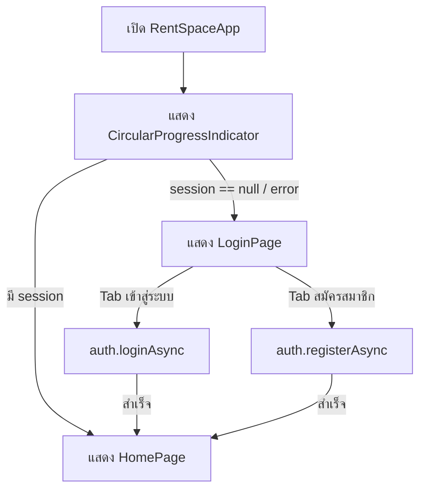

# แผนงาน Widget Test 01: Login & Auth (`login_page_test.dart`)

- **ไฟล์เทส:** `rentspace-frontend/test/pages/login_page_test.dart`
- **UI ที่ทดสอบ:** `RentSpaceApp`, `_MobileFrame` (`lib/app.dart`) และ `LoginPage` (`lib/ui/login_page.dart`)
- **Fixture กลาง:** `test/fixtures/mock_controllers.dart`
- **จำนวนเคส:** 6 เคส

## ขอบเขตและ Flow

```text
+-------------------------------------------------------------------+
| RentSpaceApp (initState -> restoreSessionAsync)                   |
|   ├── กำลังโหลด  --> CircularProgressIndicator                    |
|   ├── ไม่พบ/Error --> LoginPage (syncError banner + Form)         |
|   └── พบ Session --> HomePage                                     |
+-------------------------------------------------------------------+
| LoginPage                                                         |
|   ├── ThemeToggle (โหมดมืด / โหมดสว่าง)                          |
|   ├── Tab 0: เข้าสู่ระบบ (email, password + eye, done/button)     |
|   └── Tab 1: สมัครสมาชิก (name, email, phone, password, confirm) |
+-------------------------------------------------------------------+
| Desktop Viewport (> 430px) -> _MobileFrame จำกัดกรอบ 430 x 932    |
+-------------------------------------------------------------------+
```



## Mock & Helpers ที่ต้องใช้

- `createMockStore(signedIn: false)` และ `ControllerBundle(store)`
- Stub หลักบน `mocks.auth`:
  - `restoreSessionAsync()` (ใช้ `Completer<AppUser?>` หรือ throw `DomainError`)
  - `loginAsync(email, password)` (คืนสำเร็จพร้อม `populateMockStore` หรือ throw `DomainError` / `ApiError`)
  - `registerAsync(name, email, password, role, phone, confirmPassword)`
  - `logoutAsync()` (default stub ใน `ControllerBundle`)
- **Finders / Tooltips สำคัญ:**
  - ช่องกรอก: `fieldByLabel('ชื่อ-นามสกุล')`, `fieldByLabel('อีเมล')`, `fieldByLabel('เบอร์โทรศัพท์ติดต่อ (เช่น 081-234-5678)')`, `fieldByLabel('รหัสผ่าน (อย่างน้อย 8 ตัวอักษร)')`, `fieldByLabel('ยืนยันรหัสผ่าน')`
  - ปุ่ม/แท็บ: `FilledButton` `'เข้าสู่ระบบ'`, `'สมัครสมาชิก'`, `'สร้างบัญชี'`, `DropdownButtonFormField<UserRole>` (`'เจ้าของพื้นที่'`)
  - Tooltips: `'แสดงรหัสผ่าน'`, `'ซ่อนรหัสผ่าน'`, `'แสดงยืนยันรหัสผ่าน'`, `'ซ่อนยืนยันรหัสผ่าน'`, `'โหมดมืด'`, `'โหมดสว่าง'`, `'ออกจากระบบ'`

## รายการ Test Cases (Checklist)

- [ ] **TC1 — Session Restore ตอนเปิดแอป**
  - **Setup:** สร้าง `Completer<AppUser?>` ผูกกับ `mocks.auth.restoreSessionAsync()`.
  - **Action & Expect:**
    1. Render `RentSpaceApp` -> ต้องพบ `CircularProgressIndicator` 1 ตัว.
    2. `complete(null)` + `pumpAndSettle()` -> ต้องหายจาก spinner และแสดง `LoginPage`.
    3. ทดสอบรอบที่สอง: `populateMockStore(savedStore, viewerId: '1002')` แล้ว `complete(savedStore.currentUser)` -> ต้องเข้า `HomePage` และพบข้อความ `'ค้นหา'`.
- [ ] **TC2 — Validation, Error Messages และ Password Toggle**
  - **Setup:** Render `LoginPage` เดี่ยวใน `MaterialApp(locale: Locale('th'))` และ stub `loginAsync` สำหรับ 4 กรณี: ค่าว่าง (`DomainError('กรุณากรอกอีเมลและรหัสผ่าน')`), รหัสผิด (`ApiError('อีเมลหรือรหัสผ่านไม่ถูกต้อง', 401)`), บัญชีระงับ (`ApiError('บัญชีนี้ถูกระงับการใช้งาน', 403)`), เครือข่ายล่ม (`ApiError('เชื่อมต่อเซิร์ฟเวอร์ไม่ได้ กรุณาตรวจสอบเครือข่ายและ API_BASE_URL', 0)`).
  - **Action & Expect:**
    1. กด `'เข้าสู่ระบบ'` ทั้งที่ช่องว่าง -> เห็นข้อความ error และ dismiss SnackBar.
    2. กรอกอีเมล + รหัสผิด -> เห็น error และ `store.currentUser == null`.
    3. กด tooltip `'แสดงรหัสผ่าน'` แล้ว `'ซ่อนรหัสผ่าน'`.
    4. ทดสอบบัญชีถูกระงับ (`!entry.active`) และเครือข่ายล่ม -> ยังอยู่บน `LoginPage` และข้อความ error ตรงทุกเคส.
- [ ] **TC3 — Login Loading Spinner, Poll Retry Banner และ Logout**
  - **Setup:** ใช้ `Completer<void>` กับ `loginAsync('renter01@rentspace.test', 'password')`.
  - **Action & Expect:**
    1. กรอกข้อมูลถูกต้องแล้วกด `'เข้าสู่ระบบ'` + `pump()` -> ต้องพบ `CircularProgressIndicator`.
    2. `complete()` -> เข้า `HomePage` และ `store.currentUser?.id == '1002'`.
    3. ตั้ง `store.failNextRefresh = true;` แล้วเรียก `await store.poll();` -> แสดง `'เชื่อมต่อข้อมูลไม่สำเร็จ'` และปุ่ม `'ลองใหม่'`.
    4. กด `'ลองใหม่'` -> ปุ่ม `'ลองใหม่'` หายไป.
    5. กด tooltip `'ออกจากระบบ'` -> `verify(() => mocks.auth.logoutAsync()).called(1)`, `store.currentUser == null`, กลับสู่ `LoginPage`.
- [ ] **TC4 — แท็บสมัครสมาชิกและเลือกบทบาท Owner**
  - **Setup:** Stub `registerAsync('', ...)` ให้ throw `DomainError('กรุณาระบุชื่อและอีเมลที่ถูกต้อง')` และ stub กรอกครบสำหรับ `UserRole.owner`.
  - **Action & Expect:**
    1. แตะ `'สมัครสมาชิก'`, ทดสอบ tooltip `'แสดงยืนยันรหัสผ่าน'` / `'ซ่อนยืนยันรหัสผ่าน'`.
    2. กด `'สร้างบัญชี'` ค่าว่าง -> เห็นข้อความ error.
    3. กรอกชื่อ, อีเมล, เบอร์, รหัสผ่าน, ยืนยันรหัสผ่าน, เปิด `DropdownButtonFormField<UserRole>` เลือก `'เจ้าของพื้นที่'` แล้วกด `'สร้างบัญชี'`.
    4. `store.currentUser?.role == UserRole.owner`, เข้า `HomePage` และเห็นแท็บ `'ภาพรวม'`.
- [ ] **TC5 — ThemeToggle และ Keyboard Submit (`TextInputAction.done`)**
  - **Setup:** Stub `loginAsync` และ `registerAsync` สำหรับ user `'1002'`.
  - **Action & Expect:**
    1. แตะ tooltip `'โหมดมืด'` -> `store.darkMode == true`; แตะ `'โหมดสว่าง'` -> `store.darkMode == false`.
    2. กด `'แสดงรหัสผ่าน'`, กรอกอีเมล/รหัสผ่าน, เรียก `showKeyboard(...)` + `tester.testTextInput.receiveAction(TextInputAction.done)` -> `verify loginAsync` ถูกเรียก 1 ครั้ง และเข้า `HomePage`.
    3. ตั้ง `store.currentUser = null; store.notify();` เพื่อกลับ `LoginPage`, สลับไป `'สมัครสมาชิก'`, กด `'แสดงยืนยันรหัสผ่าน'`, กรอกครบแล้วส่ง `TextInputAction.done` จากช่อง `'ยืนยันรหัสผ่าน'` -> `verify registerAsync` ถูกเรียก 1 ครั้ง และเข้า `HomePage`.
- [ ] **TC6 — Desktop `_MobileFrame` และ Restore Session Error Fallback**
  - **Setup:** `mocks.auth.restoreSessionAsync()` throw `DomainError('session expired offline')`.
  - **Action & Expect:**
    1. ตั้ง viewport `Size(1280, 1024)` -> ต้องแสดง `LoginPage` พร้อม `store.syncError == 'session expired offline'` และ `tester.getSize(find.byType(LoginPage))` ต้องเป็น `kMobileMaxWidth - 2` × `kMobileMaxHeight - 2`.
    2. เปลี่ยน viewport เป็น `Size(800, 700)` -> กว้าง `kMobileMaxWidth - 2`, สูง `700`, `tester.takeException() == null`.

## คำสั่งรันทดสอบเฉพาะไฟล์นี้

```powershell
cd e:\666\rentspace-frontend
flutter test test/pages/login_page_test.dart
```
