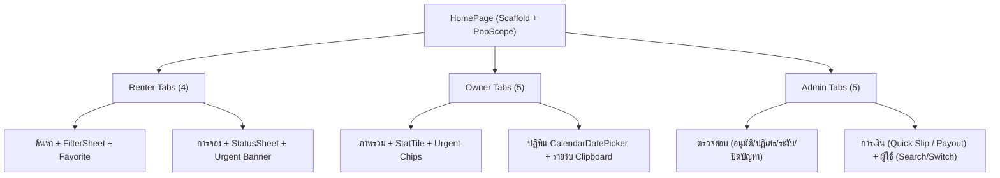

# แผนงาน Widget Test 02: Home & Dashboards (`home_page_test.dart`)

- **ไฟล์เทส:** `rentspace-frontend/test/pages/home_page_test.dart`
- **UI ที่ทดสอบ:** `HomePage`, `_MobileTopBar`, `ProfilePanel` (`lib/ui/home_page.dart`) และ `StatTile`, `TabStrip` (`lib/ui/common.dart`)
- **Fixture กลาง:** `test/fixtures/mock_controllers.dart`
- **จำนวนเคส:** 10 เคส (แยกตาม Role: Renter / Owner / Admin + Navigation/Error)

## ขอบเขตและ Flow

```text
+-------------------------------------------------------------------+
| _MobileTopBar: โลโก้ "rentSPACE" | ThemeToggle | Profile | Logout|
| Sync Error Banner: "เชื่อมต่อข้อมูลไม่สำเร็จ" + ปุ่ม "ลองใหม่"    |
+-------------------------------------------------------------------+
| Role 1 (Renter - 1002): [ค้นหา] [การจอง] [รายการโปรด] [โปรไฟล์]   |
| Role 2 (Owner  - 1001): [ภาพรวม] [พื้นที่] [การจอง] [รายรับ] [โปรไฟล์]
| Role 3 (Admin  - 1003): [ภาพรวม] [ตรวจสอบ] [การเงิน] [ผู้ใช้] [โปรไฟล์]
+-------------------------------------------------------------------+
```



## Mock & Keys สำคัญ

- **Keys:** `ValueKey('open-filter-btn')`, `ValueKey('sort-priceAsc')`, `ValueKey('sort-priceDesc')`, `ValueKey('sort-capacityDesc')`, `ValueKey('sort-recommended')`, `ValueKey('booking-status-filter-btn')`, `ValueKey('user-search-field')`
- **Tooltips:** `'ออกจากระบบ'`, `'โหมดมืด'`, `'โหมดสว่าง'`, `'ล้างคำค้นหา'`, `'รายการโปรด'`, `'คัดลอกเลขบัญชี'`, `'แสดงรหัสผ่าน'`, `'ซ่อนรหัสผ่าน'`, `'กลับหน้าหลัก'`

## รายการ Test Cases (Checklist)

- [ ] **TC1 — เมนู `NavigationBar` ของทั้ง 3 บทบาทและ Logout**
  - ล็อกอินผ่าน `LoginPage` ตามลำดับ (`renter01`, `owner01`, `admin01`) ตรวจข้อความเมนูใน `NavigationBar` ให้ครบทุกแท็บของแต่ละบทบาท แล้วกด `'ออกจากระบบ'` (`verify loginAsync` 3 ครั้ง, `logoutAsync` 3 ครั้ง).
- [ ] **TC2 — Renter: Search, FilterSheet, Empty State, ThemeToggle และ Favorites**
  - ใช้ `viewerId: '1002'` ล้าง `favorites` เริ่มต้น:
    - ตรวจจำนวนพื้นที่อนุมัติ (`พบ N พื้นที่ที่ตรงกับเงื่อนไข`), สลับ `โหมดมืด`/`โหมดสว่าง`.
    - ค้นหา `'ไม่พบชื่อนี้แน่นอน'` -> เห็น `'ไม่พบพื้นที่ ลองเปลี่ยนคำค้นหาหรือประเภท'` -> กด `'ล้างคำค้นหา'` -> ค้นหา `'The Quiet Nook'` ได้ 1 รายการ.
    - เปิด `open-filter-btn` เลือก `meeting_room`, `sort-priceAsc`, `ไม่เกิน ฿600`, `8+ คน` กด `'ดูผลลัพธ์'` -> เห็น `'ตัวกรอง (4)'`, เลือก `12+ คน` แล้วกด `'ล้างตัวกรอง'`.
    - กด tooltip `'รายการโปรด'` เพิ่ม/ลบ ตรวจแท็บ `รายการโปรด (1 รายการ)` และ empty state (`'ยังไม่มีรายการโปรดที่ตรงกับตัวกรอง'`).
    - แตะโปรไฟล์ tooltip และแตะ `'rentSPACE'` กลับมาหน้าค้นหา.
- [ ] **TC3 — Owner: เตือนไม่มีบัญชี, Urgent Chips, ปฏิทิน และรายรับ**
  - ใช้ `viewerId: '1001'`, ตั้ง `bankInfo = ''`:
    - แตะ `'ยังไม่ได้ระบุบัญชีรับเงิน'` -> เข้า `'โปรไฟล์ของฉัน'` -> กรอก `'บัญชีธนาคารรับเงินโอน (เช่น กสิกรไทย 123-4-56789-0)'` -> กด `'บันทึกโปรไฟล์'` (`verify auth.updateProfileAsync`).
    - กลับ `'ภาพรวม'` ตรวจ `'แจ้งเตือนผู้ให้เช่า (...)'`, `'คำขอรออนุมัติ (...)'`, `'รอกดยืนยันจบงาน (...)'`.
    - กดชิป `'คำขอรออนุมัติ'` -> สลับแท็บ `'ปฏิทิน'` (`CalendarDatePicker`) และ `'ประวัติ'`.
    - ไปแท็บ `'รายรับ'` -> กด `'คัดลอกสรุปรายรับ'` (`lastMockClipboard` มี `'รายงานรายรับ RentSpace'`), tooltip `'คัดลอกเลขบัญชี'`, และ `'แก้ไขบัญชี'`.
- [ ] **TC4 — Admin: Moderation, Close Issue, Space Filter, Finance และ Users**
  - ใช้ `viewerId: '1003'` (ตรวจว่ามี issue เปิดอยู่และ space rejected):
    - กด `'ประกาศรอตรวจ'` -> `'อนุมัติประกาศ'` (`space.reviewAsync`).
    - กด `'รายงานปัญหา'` -> `'บันทึกผลและปิดรายงาน'` -> `submitReasonDialog` (`space.closeIssueAsync`).
    - กด `'พื้นที่ทั้งหมด'` -> `'ถูกระงับ'` -> `'เปิดใช้งานใหม่'` (`space.activateSpaceAsync`).
    - แท็บ `'การเงิน'`: กด `'คัดลอกสรุปการเงิน'`, เปิด `'สถานะอื่นๆ'` กรอง `'ยกเลิกแล้ว'` แล้วกลับ `'ทั้งหมด'`.
    - แท็บ `'ผู้ใช้'`: ค้นหาไม่พบ -> `'ล้างคำค้นหา'` -> กรอง `'ผู้เช่า'` ค้นหา `'มินท์ กมลวรรณ'` -> สลับ `Switch` 2 ครั้ง (`verify auth.toggleUserAsync` 2 ครั้ง).
- [ ] **TC5 — Sync Error Banner และปุ่ม Retry**
  - ตั้ง `store.failNextRefresh = true;` ก่อนเปิด `RentSpaceApp` -> เห็น `'เชื่อมต่อข้อมูลไม่สำเร็จ'` -> กด `'ลองใหม่'` -> `store.refreshCalls == 2`, `store.syncError == null`, ปุ่ม `'ลองใหม่'` หายไป.
- [ ] **TC6 — System Back (`PopScope`), Confirmation -> Reserve -> Home และ Logout**
  - สลับไปแท็บ `'การจอง'` แล้วเรียก `Navigator.of(...).maybePop()` -> ต้องกลับมาหน้าค้นหา.
  - กด `'ดูรายละเอียดและจอง'` -> `'ส่งคำขอจอง'` -> `'กลับไปแก้ไขข้อมูลการจอง'` -> กด `Icons.arrow_back` กลับมา `HomePage`.
  - กด `'ออกจากระบบ'` -> `store.currentUser == null`, `store.bookings.isEmpty`, กลับสู่ `LoginPage`.
- [ ] **TC7 — Renter: Reset FilterSheet, Urgent Banner, Status Sheet และเปลี่ยนรหัสผ่าน**
  - ใน `open-filter-btn` เลือก `sort-priceAsc` แล้วกด `'ล้างค่าทั้งหมด'` -> ปิด sheet ตรวจว่าไม่มี `'ล้างตัวกรอง'`.
  - แท็บ `'การจอง'`: กด `'ดำเนินการ'` บน urgent banner เปิด `BookingPage` แล้วกลับด้วย `'กลับหน้าหลัก'`, สลับ `TabStrip` (`ประวัติ (`, `ทั้งหมด (`, `กำลังดำเนินการ (`), เปิด `booking-status-filter-btn` เลือก `'รอเจ้าของอนุมัติ'` แล้วกด `'ล้าง'`, แตะการ์ดจองเปิด `BookingPage`.
  - แท็บ `'โปรไฟล์'`: กด `'แสดงรหัสผ่าน'`, กด `'บันทึกรหัสผ่านใหม่'` ตอนว่าง (แสดง error), กรอกรหัสปัจจุบัน/ใหม่/ยืนยันแล้วบันทึก (`verify auth.changePasswordAsync`).
- [ ] **TC8 — Owner: Urgent Complete Chip, Inline Approve/Reject และเลือกวันบนปฏิทิน**
  - กดชิป `'รอกดยืนยันจบงาน (1)'` -> กด `'ยืนยันจบงาน (ใช้บริการแล้ว)'` (`verify booking.completeAsync('3001')`).
  - กด `'ล้าง'` ตัวกรอง -> ทดสอบ inline `'อนุมัติคำขอ'` (`ownerReviewAsync('3003', true, '')`) และ `'ปฏิเสธคำขอ'` + `submitReasonDialog` (`ownerReviewAsync('3003', false, ...)`).
  - แท็บ `'ปฏิทิน'` แตะวันที่ `'20'` -> เห็น `'รายการวันที่ 20/11/2569'` แล้วสลับดูแท็บ `'ประวัติ'`.
- [ ] **TC9 — Admin: Urgent Chips, Reject/Suspend Space, Quick Slip Reject และ User Role Chips**
  - ตรวจชิป `'สลิปรอตรวจ (1)'` และ `'รอโอนให้เจ้าของ (1)'`.
  - แท็บ `'ตรวจสอบ'`: กด `'ปฏิเสธประกาศ'` (`2005`), สลับแท็บ `'พื้นที่ทั้งหมด ('` กรองชิป `เปิดใช้งาน (2)`, `ถูกระงับ (1)`, `รอตรวจ (1)`, `ทั้งหมด (4)`, และกด `'ระงับประกาศ'` (`2001`).
  - แท็บ `'การเงิน'`: กด `StatTile` / `ChoiceChip` / `'สถานะอื่นๆ'` (`'เสร็จสิ้น'`), กด `'ตรวจสลิปด่วน'` -> `'ปิด'` และเปิดใหม่กด `'ปฏิเสธสลิป'` (`payment.reviewAsync('3005', false, ...)`), แตะไอคอน copy (`size == 13`) ตรวจ `lastMockClipboard`, เปิด `'โอนให้เจ้าของ ('` แล้ว `'ยกเลิก'`.
  - แท็บ `'ผู้ใช้'`: สลับชิป `'ผู้เช่า'`, `'ผู้ดูแลระบบ'`, `'เจ้าของพื้นที่'` (กด `Icons.copy_outlined` ตรวจเลขบัญชี), กลับ `'ทุกบทบาท'`.
- [ ] **TC10 — Dashboard `StatTile` 4 ช่อง, แตะการ์ดเปิดหน้าย่อย และ FilterSheet ที่เหลือ**
  - **Renter:** ทดสอบ `sort-priceDesc`, `sort-capacityDesc`, `sort-recommended`, `'ทุกราคา'`, `'ทุกความจุ'`, `'ทั้งหมด'`, และแตะการ์ดพื้นที่ตรงๆ เปิด `ReservePage` แล้วกด `BackButton`.
  - **Owner:** กด `StatTile` ครบ 4 ช่อง (`พื้นที่`, `คำขอรออนุมัติ`, `คิวจองที่ยืนยันแล้ว`, `รายรับสุทธิที่เสร็จสิ้น`) และแตะการ์ดในแท็บ `'รายรับ'` เปิด `BookingPage`.
  - **Admin:** กด `StatTile` ครบ 4 ช่อง (`พื้นที่`, `คำขอรออนุมัติ`, `สลิปรอตรวจ`, `รายรับสุทธิที่เสร็จสิ้น`) และแตะการ์ดในแท็บ `'การเงิน'` เปิด `BookingPage`.

## คำสั่งรันทดสอบเฉพาะไฟล์นี้

```powershell
cd e:\666\rentspace-frontend
flutter test test/pages/home_page_test.dart
```
