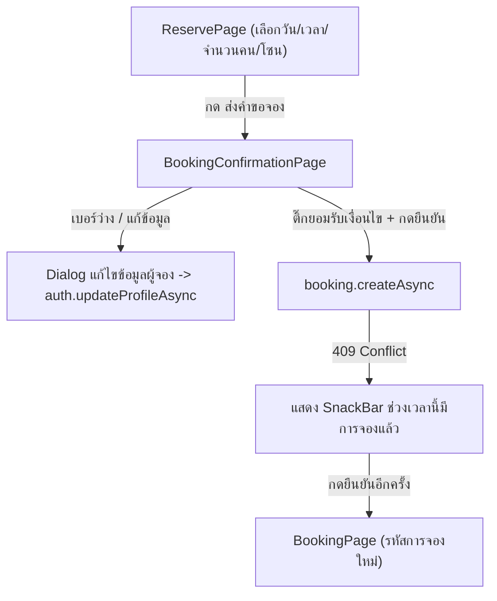

# แผนงาน Widget Test 03: Reserve & Confirm (`reserve_and_confirm_page_test.dart`)

- **ไฟล์เทส:** `rentspace-frontend/test/pages/reserve_and_confirm_page_test.dart`
- **UI ที่ทดสอบ:** `ReservePage` และ `BookingConfirmationPage` (`lib/ui/booking_pages.dart`)
- **Fixture กลาง:** `test/fixtures/mock_controllers.dart`
- **จำนวนเคส:** 3 เคส

## ขอบเขตและ Flow

```text
+-------------------------------------------------------------------+
| ReservePage                                                       |
| - เลือกวันที่ (Calendar DatePicker) / โหมดรายชั่วโมง vs เหมาหลายวัน |
| - ช่วงเวลา (slot-start-end / SimpleDialog เริ่ม-สิ้นสุด)          |
| - จำนวนคน (increment / decrement / preset) + โซน + หมายเหตุ       |
| - รายงานปัญหาพื้นที่ / ปุ่ม "ส่งคำขอจอง"                          |
+-------------------------------------------------------------------+
                                 |
                                 v
+-------------------------------------------------------------------+
| BookingConfirmationPage                                           |
| - สรุปสถานที่ วันเวลา ราคา ค่าบริการ และข้อมูลผู้จอง (+ แก้ไขเบอร์) |
| - Checkbox ยอมรับเงื่อนไข -> ปุ่ม confirm-booking-btn             |
| - รองรับ HTTP 409 conflict แล้วกดจองซ้ำ -> ไปหน้า BookingPage       |
+-------------------------------------------------------------------+
```



## Mock & Keys สำคัญ

- **Localization:** ต้องใส่ `Locale('th', 'TH')` / `GlobalMaterialLocalizations` delegates เมื่อทดสอบ `showDatePicker` เพื่อให้ปุ่ม `'ตกลง'` แสดงภาษาไทย
- **Keys:**
  - `ReservePage`: `ValueKey('days-preset-3')`, `ValueKey('days-increment')`, `ValueKey('days-decrement')`, `ValueKey('slot-780-840')`, `ValueKey('slot-840-900')`, `ValueKey('attendees-increment')`, `ValueKey('attendees-decrement')`, `ValueKey('attendees-preset-<N>')`
  - `BookingConfirmationPage`: `ValueKey('confirm-booking-btn')`
- **Stubs หลัก:** `mocks.booking.createAsync(...)`, `mocks.space.reportAsync(...)`, `mocks.auth.updateProfileAsync(...)`

## รายการ Test Cases (Checklist)

- [ ] **TC1 — เลือกวัน/ชั่วโมง/จำนวนคน, รับมือ 409 Conflict และสร้างการจองสำเร็จ**
  - **Setup:** `viewerId: '1002'`, `space('2001')`; stub `booking.createAsync` ให้ครั้งแรก throw `ApiError('ช่วงเวลานี้มีการจองแล้ว', 409)` และครั้งที่ 2 สร้าง `Booking` (`id: '3999'`).
  - **Action & Expect:**
    1. กด `Icons.calendar_month` -> แตะ `'17'` -> `'ตกลง'`.
    2. แตะ `slot-780-840`, `slot-840-900`, กด `attendees-increment`, แล้วกด `FilledButton` `'ส่งคำขอจอง'`.
    3. ตรวจว่าเข้า `BookingConfirmationPage`.
    4. แตะ `'ฉันยอมรับเงื่อนไขการจองและกฎการใช้สถานที่'` -> กด `confirm-booking-btn` ครั้งแรก -> เห็น `'ช่วงเวลานี้มีการจองแล้ว'` -> dismiss SnackBar.
    5. กด `confirm-booking-btn` ครั้งที่สอง -> เข้า `BookingPage` แสดง `'รหัสการจอง: 3999'` และ `verify booking.createAsync` ถูกเรียก 2 ครั้ง (`780`, `900`, `days: 1`, `attendees: 2`).
- [ ] **TC2 — Multi-day, Time Dialogs, Zone/Note, Report, แก้ไขเบอร์ที่ว่าง และกลับหน้าหลัก**
  - **Setup:** `viewerId: '1004'` และตั้ง `store.currentUser!.phone = ''`; stub `space.reportAsync`, `auth.updateProfileAsync`, และ `booking.createAsync` (409 ครั้งแรก -> สำเร็จครั้งที่ 2).
  - **Action & Expect:**
    1. เปิด `RentSpaceApp` กด `'ดูรายละเอียดและจอง'` เข้า `ReservePage`.
    2. เลือกวันที่ `'17'`, สลับ `'เหมาหลายวัน (ต่อเนื่อง)'` -> กด `days-preset-3`, `days-increment`, `days-decrement`, `'ใช้เวลาเต็มวัน'` -> กลับ `'รายชั่วโมง (1 วัน)'`.
    3. เลือก `slot-780-840` + `slot-840-900` แล้วทดสอบ `SimpleDialog` ปุ่ม `'เริ่ม 13:00'` เลือก `'14:00'`, `'สิ้นสุด 15:00'` เลือก `'24:00'`, แล้วเลือก `slot-780-840` ใหม่.
    4. กด `attendees-increment`, `attendees-decrement`, และ `attendees-preset-*` (ถ้ามี), แตะ `'ห้องส่วนตัว / ประชุมย่อย'` และ `'ขอโปรเจกเตอร์/จอภาพ'`.
    5. กด `'รายงานปัญหาพื้นที่'` + `submitReasonDialog` -> เห็น `'ส่งรายงานแล้ว'`.
    6. เข้า `BookingConfirmationPage` กด `TextButton` `'ระบุเบอร์'` กรอก `'089-888-7777'` กด `'บันทึก'`, ติ๊กเงื่อนไข, ผ่าน 409 ไป `BookingPage` แล้วกด tooltip `'กลับหน้าหลัก'` กลับ `HomePage`.
    7. Verify `space.reportAsync` 1 ครั้ง และ `auth.updateProfileAsync(..., '089-888-7777', ...)` 1 ครั้ง.
- [ ] **TC3 — วันปิด/ช่วงเวลาไม่ว่าง (Disable ปุ่มส่ง) และ Guard ของ `BookingConfirmationPage`**
  - **Setup:** ปิด `availability.days` ทุกวัน (`open = false`) บน `space('2001')` และเพิ่ม `store.busySlots` วันที่ถัดไปช่วง `600..720` (`10:00–12:00`).
  - **Action & Expect:**
    1. Push เข้า `ReservePage` -> ต้องเห็น `'คิวจอง 10:00–12:00'`, `'ช่วงเวลานี้ไม่ว่าง / นอกเวลาเปิด'`, และ `FilledButton('ส่งคำขอจอง').onPressed == null`.
    2. เปิด `BookingConfirmationPage` โดยตรง: ก่อนติ๊กยอมรับเงื่อนไข `confirm-booking-btn.onPressed == null`.
    3. กด `'แก้ไข'` เปิด `'แก้ไขข้อมูลผู้จอง'`, ล้าง `'เบอร์โทรศัพท์'` แล้วกด `'บันทึก'` (stub `updateProfileAsync` โยน `DomainError`) -> ต้องเห็น error และ dialog ยังเปิดอยู่.
    4. กด `'ยกเลิก'` ปิด dialog (`verifyNever` ว่าไม่มีการบันทึกเบอร์เดิม), จากนั้นกด AppBar tooltip `'ย้อนกลับ'` เพื่อยืนยันว่า pop ออกจาก `BookingConfirmationPage` ได้.

## คำสั่งรันทดสอบเฉพาะไฟล์นี้

```powershell
cd e:\666\rentspace-frontend
flutter test test/pages/reserve_and_confirm_page_test.dart
```
