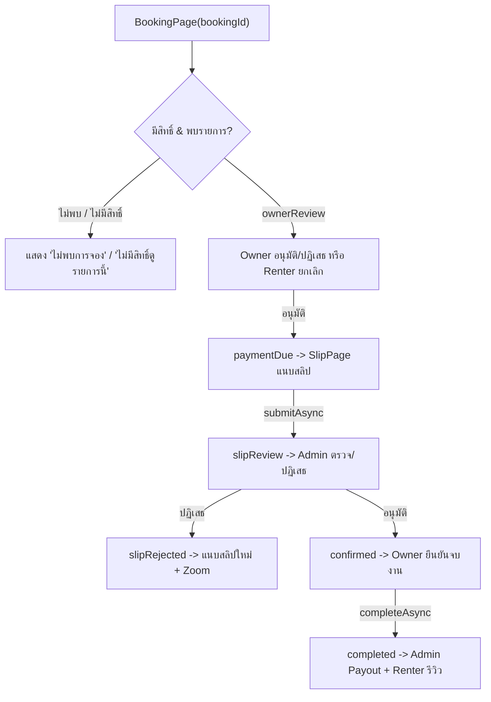

# แผนงาน Widget Test 04: Booking Detail & Slip (`booking_detail_page_test.dart`)

- **ไฟล์เทส:** `rentspace-frontend/test/pages/booking_detail_page_test.dart`
- **UI ที่ทดสอบ:** `BookingPage`, `SlipPage`, `showAdminPayoutDialog`, `_ReviewFormCard`, `BookingInfoRow` (`lib/ui/booking_detail_page.dart`)
- **Fixture กลาง:** `test/fixtures/mock_controllers.dart`
- **จำนวนเคส:** 5 เคส

## ขอบเขตและ Flow

```text
+-------------------------------------------------------------------+
| BookingPage (รับ bookingId + pickSlip + Controllers)              |
|   ├── Guard: ไม่พบการจอง / ไม่มีสิทธิ์ดูรายการนี้                |
|   ├── Copy: รหัสการจอง | หลักฐานการจอง | เลขบัญชีโอนเงิน        |
|   ├── Renter: ยกเลิกคำขอ, แจ้งปัญหา, แนบสลิป (SlipPage), รีวิว   |
|   ├── Owner : อนุมัติคำขอ, ปฏิเสธคำขอ, ยืนยันใช้บริการแล้ว        |
|   └── Admin : ตรวจสลิป, ปฏิเสธสลิป, ยกเลิก, จ่ายเงินเจ้าของ      |
+-------------------------------------------------------------------+
```



## Mock, Keys & Injection สำคัญ

- **Injection `pickSlip`:** ส่งฟังก์ชันจำลองเข้า `BookingPage(..., pickSlip: ...)` / `SlipPage(..., pickSlip: ...)` / `showAdminPayoutDialog(..., pickSlip: ...)` เพื่อไม่ต้องพึ่ง FilePicker จริง
- **Keys:**
  - `BookingPage`: `ValueKey('copy-booking-id-btn')`, `ValueKey('copy-booking-evidence-btn')`, `ValueKey('copy-account-btn')`
  - `_AdminPayoutDialog`: `ValueKey('payout-pick-slip-btn')`, `ValueKey('payout-clear-slip-btn')`, `ValueKey('payout-note-field')`, `ValueKey('payout-confirm-btn')`
- **Tooltips:** `'กลับหน้าหลัก'`, `'4 ดาว'` (1–5 ดาว), `'คัดลอกบัญชีรับเงิน'`
- **ข้อควรระวัง:** `BookingPage` สร้าง `Timer.periodic(30s)` ใน `initState` ดังนั้นทุกเคสต้องเรียก `await unmountApp(tester);` ก่อนจบหรือก่อนสลับ `pumpWidget`

## รายการ Test Cases (Checklist)

- [ ] **TC1 — ปุ่ม Action ตามสถานะและบทบาท (`ownerReview`, `confirmed`, Admin Cancel, `ownerRejected`)**
  - **Setup:** ใช้ `findBookingByStatus` หา `'3003'` (`ownerReview`), `'3001'` (`confirmed` อดีต), `'3002'` (`confirmed` อนาคต), `'3020'` (`ownerRejected`).
  - **Action & Expect:**
    1. Renter (`1002`) เปิด `3003` -> เห็น `'ยกเลิกคำขอ'` และไม่เห็น `'อนุมัติคำขอ'`, `'ปฏิเสธคำขอ'`, `'ทำเครื่องหมายว่าใช้บริการแล้ว'`.
    2. สลับ `store.currentUser = store.user('1001'); store.notify();` -> เห็น `'อนุมัติคำขอ'`, `'ปฏิเสธคำขอ'`, กด `'อนุมัติคำขอ'` (`verify booking.ownerReviewAsync(id, true, '')`) -> แสดง `'รอชำระเงิน'`.
    3. เปิด `3002` (อนาคต) -> ปุ่ม `'ทำเครื่องหมายว่าใช้บริการแล้ว'` ต้องถูก disable (`onPressed == null`); สลับเป็น Admin (`1003`) กด `'Admin ยกเลิกการจอง'` + `submitReasonDialog` -> สถานะเป็น `BookingStatus.canceled`.
    4. Owner (`1001`) เปิด `3001` (อดีต) -> กด `'ทำเครื่องหมายว่าใช้บริการแล้ว'` (`verify booking.completeAsync('3001')`).
    5. เปิด `3020` (`ownerRejected`) -> ต้องไม่พบปุ่ม action ใดๆ.
- [ ] **TC2 — Clipboard Copy, อัปโหลดสลิป, Admin ปฏิเสธ, ส่งซ้ำ และ Zoom Dialog**
  - **Setup:** `viewerId: '1002'`, `3004` (`paymentDue`), เตรียม `Queue<SlipPickResult>` 2 ใบ (`slip1.png`, `slip2.png`).
  - **Action & Expect:**
    1. กด `copy-booking-id-btn` -> `lastMockClipboard == bookingId`; กด `copy-booking-evidence-btn` -> มี `bookingId`; กด `copy-account-btn` -> `'000-0-00000-0'`.
    2. กด `'แนบ / ส่งสลิปใหม่'` เข้า `SlipPage`: ก่อนเลือกภาพปุ่ม `'ส่งสลิปเพื่อตรวจสอบ'` ต้อง disable (`onPressed == null`) -> กด `'เลือกภาพสลิป'`, กรอก `'หมายเหตุ (ไม่บังคับ)'`, กดส่ง (`payment.submitAsync`).
    3. สลับเป็น Admin (`1003`) กด `'ปฏิเสธสลิป'` + `submitReasonDialog('สลิปเบลอ ยอดไม่ตรง')` (`payment.reviewAsync`).
    4. สลับกลับ Renter เห็นเหตุผลปฏิเสธ -> ส่งสลิปใบที่ 2 -> `slips.length == 2` -> กดขยาย `'ประวัติสลิปก่อนหน้า (1 รายการ)'` -> แตะ `SlipImage.first` เปิด Zoom Dialog และปิดด้วย `Icons.close`.
- [ ] **TC3 — Admin Quick Slip, Payout Dialog พร้อมสลิป และ Renter รีวิว**
  - **Setup:** `viewerId: '1003'`, `3005` (`slipReview`), `3006` (`completed`, `paidOutAt == null`, `review = null`).
  - **Action & Expect:**
    1. เปิด `RentSpaceApp` ไปแท็บ `'การเงิน'` -> กด `'ตรวจสลิปด่วน'` ของ `3005` -> กด `'อนุมัติสลิป'` -> สถานะเป็น `BookingStatus.confirmed`.
    2. เรียก `showAdminPayoutDialog(..., pickSlip: ...)` สำหรับ `3006` -> กด `payout-pick-slip-btn`, `payout-clear-slip-btn`, เลือกใหม่, กรอก `payout-note-field`, กด `payout-confirm-btn` -> `completedReviewBooking.payoutSlip != null`.
    3. สลับเป็น Renter (`1002`) เปิด `BookingPage` ของ `3006` -> ต้องไม่เห็น `'สลิปโอนเงินให้เจ้าของ (Admin)'` -> แตะ tooltip `'4 ดาว'`, กรอก `'ความคิดเห็นหลังใช้งาน'`, กด `'ส่งรีวิว'` (`verify booking.submitReviewAsync`).
- [ ] **TC4 — ปุ่มเสริมบน `BookingPage`, Copy Bank บน InfoRow และ `SlipPage` Null/Invalid Pick**
  - **Action & Expect:**
    1. Renter เข้าผ่าน `RentSpaceApp` -> แท็บ `'การจอง'` -> แตะการ์ด `'ห้องประชุมสว่างใจ'` -> กด tooltip `'กลับหน้าหลัก'`.
    2. บน `BookingPage('3003')`: Renter กด `'แจ้งปัญหาการจอง'` (`space.reportAsync`), `'ยกเลิกคำขอ'` (`booking.cancelAsync`); สลับ Owner กด `'ปฏิเสธคำขอ'` (`booking.ownerReviewAsync(..., false, ...)`).
    3. สลับ Admin บน `3005`: แตะ `Icons.copy_outlined.last` คัดลอก `'SCB 999-111-2222'`, กด `'ตรวจแล้ว ยืนยันการจอง'`; และบน `3006` เปิด `'บันทึกจ่ายเจ้าของ (แนบสลิป)'` แล้วกด `'ยกเลิก'` (`verifyNever payoutAsync`).
    4. เปิด `SlipPage` โดยใช้ `PaymentController` จริง (ไม่ mock): `pickSlip` ครั้งที่ 1 คืน `null` (ปุ่มส่งยัง disable), ครั้งที่ 2 คืน `invalid.txt` + `corruptMockImageBytes` -> กดส่งต้องแสดง `'รองรับภาพ JPG และ PNG เท่านั้น'`.
- [ ] **TC5 — Payout Dialog Copy/Validation Error และ Guards ของ `BookingPage`**
  - **Action & Expect:**
    1. เปิด `showAdminPayoutDialog` ที่ส่ง `pickSlip` คืน `'bad.txt'` -> กด tooltip `'คัดลอกบัญชีรับเงิน'` ตรวจ `lastMockClipboard`, เลือกไฟล์แล้วกด `payout-confirm-btn` -> เห็น `'รองรับภาพ JPG และ PNG เท่านั้น'` และ dialog ยังค้างอยู่ -> กด `'ยกเลิก'`.
    2. เปิด `BookingPage` ด้วย `bookingId: 'missing-booking-id'` -> แสดง `'ไม่พบการจอง'`.
    3. เปลี่ยนเป็น `user('1004')` เปิด `BookingPage` ของรายการที่ไม่มีสิทธิ์ -> แสดง `'ไม่มีสิทธิ์ดูรายการนี้'`.

## คำสั่งรันทดสอบเฉพาะไฟล์นี้

```powershell
cd e:\666\rentspace-frontend
flutter test test/pages/booking_detail_page_test.dart
```
