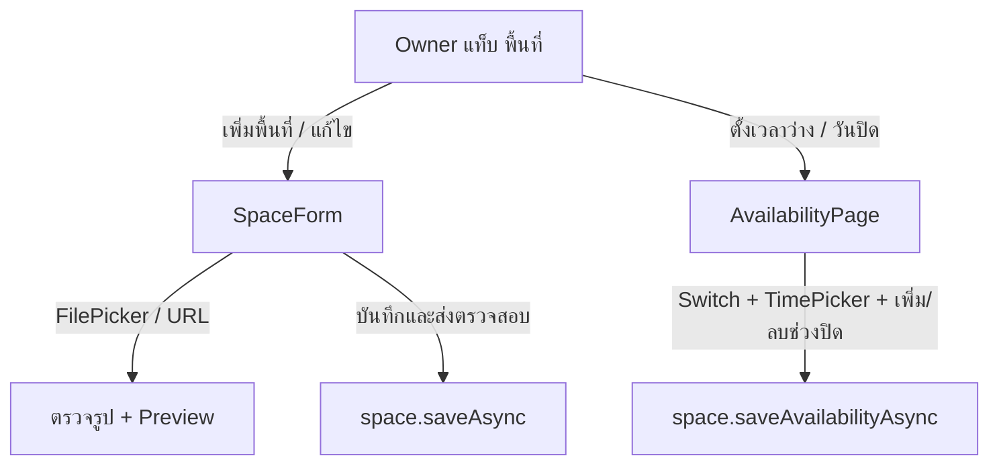

# แผนงาน Widget Test 05: Space & Availability (`space_form_page_test.dart`)

- **ไฟล์เทส:** `rentspace-frontend/test/pages/space_form_page_test.dart`
- **UI ที่ทดสอบ:** `SpaceForm` และ `AvailabilityPage` (`lib/ui/space_form.dart`)
- **Fixture กลาง:** `test/fixtures/mock_controllers.dart`
- **จำนวนเคส:** 3 เคส

## ขอบเขตและ Flow

```text
+-------------------------------------------------------------------+
| SpaceForm (เพิ่ม / แก้ไขพื้นที่)                                 |
|   ├── ข้อมูลหลัก: ชื่อ, ประเภท (ChoiceChip), ที่อยู่, ราคา, ความจุ |
|   ├── สิ่งอำนวยความสะดวก: FilterChip + ข้อความเพิ่มเติม           |
|   └── รูปภาพ: FilePicker (เลือก/เปลี่ยน/ลบ) หรือ URL (https://)   |
+-------------------------------------------------------------------+
| AvailabilityPage (ตั้งเวลาว่าง / วันปิด)                          |
|   ├── ตารางรายวัน (จันทร์–อาทิตย์): SwitchListTile + เวลาเปิด/ปิด  |
|   └── ช่วงปิดพิเศษ (BlockedPeriod): เพิ่มช่วงปิด + เหตุผล / ลบ     |
+-------------------------------------------------------------------+
```



## Mock & Helpers ที่ต้องใช้

- **`FilePickerPlatform` Mock (สำหรับ TC3):** สร้าง `_FakePlatformFile extends PlatformFile` และ `_FakeFilePickerPlatform extends FilePickerPlatform` แล้วคืนค่า `FilePickerPlatform.instance = originalPicker` ใน `addTearDown`
- **Mock Controllers:** `viewerId: '1001'` (Owner), stub `mocks.space.saveAsync(...)` และ `mocks.space.saveAvailabilityAsync(...)`
- **Finders / Labels สำคัญ:**
  - `SpaceForm`: `fieldByLabel('ชื่อพื้นที่')`, `fieldByLabel('ที่อยู่')`, `fieldByLabel('ราคา / ชั่วโมง (บาท)')`, `fieldByLabel('ความจุ (คน)')`, `fieldByLabel('คำอธิบาย')`, `fieldByLabel('ลิงก์ภาพ URL (https:// หรือ http://localhost)')`, `ChoiceChip('สตูดิโอ')`, `FilterChip('Wi-Fi')`, `FilterChip('ไวท์บอร์ด')`, `'เลือกภาพพื้นที่'`, `'เปลี่ยนภาพ'`, `'ลบภาพ'`, `'บันทึกและส่งตรวจสอบ'`
  - `AvailabilityPage`: `SwitchListTile`, `'เปิด 09:00'`, `'ปิด 18:00'`, `'เพิ่มช่วงปิด'`, tooltip `'ลบช่วงปิด'`, `'บันทึกการตั้งค่า'`

## รายการ Test Cases (Checklist)

- [ ] **TC1 — Form Validation, URL Image Preview และเพิ่ม/แก้ไขพื้นที่**
  - **Setup:** Stub `space.saveAsync` ให้ตรวจชื่อ/ที่อยู่ว่างหรือราคา/ความจุ <= 0 (โยน `DomainError`), ตรวจ prefix `https://` หรือ `http://localhost`, และสร้าง/แก้ไข `Space` ใน `store.spaces`.
  - **Action & Expect:**
    1. เปิด `RentSpaceApp` -> แท็บ `'พื้นที่'` -> `'เพิ่มพื้นที่'` -> ตรวจ `SpaceForm`.
    2. กด `'บันทึกและส่งตรวจสอบ'` ตอนว่าง -> เห็น `'กรอกข้อมูลให้ครบ ราคาและความจุต้องมากกว่า 0'`.
    3. กรอกฟิลด์ครบ, เลือก `ChoiceChip` `'สตูดิโอ'`, `FilterChip` `'Wi-Fi'` + `'ไวท์บอร์ด'`.
    4. กด `'หรือใช้ลิงก์ภาพ URL'`, ใส่ `'http://insecure.example.com/room.jpg'`, กดบันทึก -> เห็น `'ลิงก์ภาพต้องขึ้นต้นด้วย https://'`.
    5. เปลี่ยนเป็น `'https://cdn.example.invalid/space.jpg'`, รอ `runAsync(80ms)` + `pumpAndSettle()` -> เห็น `'ไม่สามารถโหลดตัวอย่างภาพจากลิงก์นี้'`.
    6. กด `'ลบภาพ'` -> กด `'บันทึกและส่งตรวจสอบ'` -> กลับ `HomePage` และพบ `'ห้องสร้างใหม่ ทดสอบ'`.
    7. เลื่อนขึ้นบนสุด กด `OutlinedButton('แก้ไข').first` -> ลบภาพ -> แก้ชื่อเป็น `'ห้องประชุมสว่างใจ (อัปเดต)'` -> บันทึก (`verify space.saveAsync` รวม 4 ครั้ง).
- [ ] **TC2 — จัดการวันเปิด-ปิดและเพิ่มช่วงปิดปรับปรุงใน `AvailabilityPage`**
  - **Setup:** Stub `space.saveAvailabilityAsync` ให้อัปเดต `targetSpace.availability` และ `store.notify()`.
  - **Action & Expect:**
    1. เข้าแท็บ `'พื้นที่'` -> กด `'ตั้งเวลาว่าง / วันปิด'` รายการแรก -> ตรวจ `AvailabilityPage`.
    2. แตะ `SwitchListTile.first` 2 ครั้ง (เปิด/ปิด).
    3. กด `'เพิ่มช่วงปิด'` -> แตะ `'ตกลง'` 3 ครั้ง (เลือกวัน, เวลาเริ่ม, เวลาสิ้นสุด) -> `submitReasonDialog(tester, 'ล้างพรมประจำเดือน')` -> เห็นข้อความ `'ล้างพรมประจำเดือน'`.
    4. กด `'บันทึกการตั้งค่า'` -> กลับหน้า `'พื้นที่ของฉัน'` และ `verify space.saveAvailabilityAsync` 1 ครั้ง.
- [ ] **TC3 — `FilePicker` (ไฟล์เสีย/ดี/เปลี่ยน/ลบ), Time Picker, ลบช่วงปิด และ Save Error**
  - **Setup:** ตั้ง `_FakeFilePickerPlatform` คิว 3 ไฟล์ (`bad.png` = `corruptMockImageBytes`, `studio_cover.png` = `validMockPngBytes`, `studio_alt.png` = `validMockPngBytes`), เพิ่ม `BlockedPeriod(id: 'BLK-REMOVE', reason: 'ตรวจระบบไฟฟ้า')` ใน `space('2001')`, และ stub `saveAvailabilityAsync` ให้จับค่า `capturedAvailability` แล้ว throw `DomainError('เวลาที่ตั้งทับรายการจองเดิม กรุณาจัดการการจองก่อน')`.
  - **Action & Expect:**
    1. เข้า `SpaceForm` -> กด `'เลือกภาพพื้นที่'` (`bad.png`) -> เห็น `'เปิดไฟล์ภาพไม่ได้ กรุณาลองใหม่'` และปุ่มยังเป็น `'เลือกภาพพื้นที่'`.
    2. กด `'เลือกภาพพื้นที่'` (`studio_cover.png`) -> เปลี่ยนเป็นปุ่ม `'เปลี่ยนภาพ'` และ `'ลบภาพ'`.
    3. กด `'เปลี่ยนภาพ'` (`studio_alt.png`) แล้วกด `'ลบภาพ'` -> กลับเป็น `'เลือกภาพพื้นที่'`.
    4. กด `BackButton` ออกไปเปิด `AvailabilityPage` ของพื้นที่แรก -> ทดสอบ `'เปิด 09:00'` -> `'ตกลง'` และ `'ปิด 18:00'` -> `'ตกลง'`.
    5. ปิด `SwitchListTile.first`, กด tooltip `'ลบช่วงปิด'` ให้ `'ตรวจระบบไฟฟ้า'` หายไป, แล้วกด `'บันทึกการตั้งค่า'`.
    6. ตรวจว่า `capturedAvailability?.days[0].open == false`, เห็น SnackBar error, และยังอยู่หน้า `AvailabilityPage`.

## จุดที่ขยายเพิ่มได้ (Optional)

- เพิ่มไฟล์จำลองใน `_FakePlatformFile` ที่ขนาดเกิน 5 MB (`length() => 6 * 1024 * 1024`) และขนาด 0 ไบต์ (`Uint8List(0)`) เพื่อทดสอบข้อความ `'ขนาดไฟล์เกิน 5 MB'` และ `'ไฟล์รูปภาพว่างเปล่า'` ใน `SpaceForm._chooseImage()` (`lib/ui/space_form.dart#L100-L107`)

## คำสั่งรันทดสอบเฉพาะไฟล์นี้

```powershell
cd e:\666\rentspace-frontend
flutter test test/pages/space_form_page_test.dart
```
