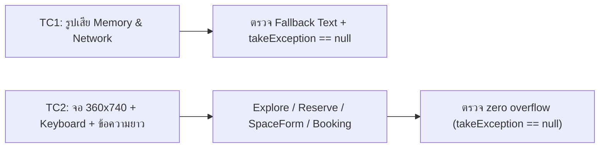

# แผนงาน Widget Test 06: Image Fallback & Responsive (`image_and_responsive_test.dart`)

- **ไฟล์เทส:** `rentspace-frontend/test/pages/image_and_responsive_test.dart`
- **UI ที่ทดสอบ:** `SpaceImage`, `SlipImage` (`lib/ui/common.dart`), `SpaceForm`, `RentSpaceApp`, `ReservePage`, `BookingPage`
- **Fixture กลาง:** `test/fixtures/mock_controllers.dart`
- **จำนวนเคส:** 2 เคส

## ขอบเขตและ Flow

```text
+-------------------------------------------------------------------+
| Test 1: Broken Image Fallbacks (Zero Crash)                       |
|   ├── SpaceImage(corruptMockImageBytes, fallback: custom)         |
|   ├── SlipImage(corruptMockImageBytes)  -> "ไม่สามารถเปิดภาพได้"  |
|   ├── SlipImage(invalid network URL)    -> "ไม่สามารถเปิดภาพได้"  |
|   └── SpaceForm(space with corruptMockImageBytes)                 |
+-------------------------------------------------------------------+
| Test 2: Narrow Viewport + Keyboard + Long Thai Text               |
|   ├── Viewport: 360 x 740, viewInsets: bottom = 300               |
|   ├── ข้อมูล: Space ชื่อ/ที่อยู่/คำอธิบาย ภาษาไทยยาวซ้ำ 16 ชุด    |
|   └── หน้าจอ: Explore -> ReservePage -> SpaceForm -> BookingPage  |
+-------------------------------------------------------------------+
```



## Mock & Helpers ที่ต้องใช้

- **Helper สำคัญในไฟล์:** `_settleBrokenImageFrames(tester)` ที่เรียก `tester.runAsync(() => Future.delayed(const Duration(milliseconds: 80)))`, `tester.pumpAndSettle()` และ `expect(tester.takeException(), isNull)` เพื่อให้ `Image.memory` / `Image.network` errorBuilder ทำงานจบโดยไม่ทิ้ง exception
- **Bytes / Viewport จาก `mock_controllers.dart`:**
  - `corruptMockImageBytes` (`[1, 2, 3, 4]`)
  - `configureMobileViewport(tester, size: const Size(360, 740), viewInsets: const FakeViewPadding(bottom: 300))`

## รายการ Test Cases (Checklist)

- [ ] **TC1 — Broken Memory & Network Images Fallback (Zero Crash)**
  - **Setup:** สร้าง `brokenSpace` (`image = ''`, `imageBytes = corruptMockImageBytes`), `brokenMemorySlip` (`corruptMockImageBytes`), และ `brokenNetworkSlip` (`bytes = Uint8List(0)`, `imageUrl = 'https://invalid.example.invalid/missing.png'`).
  - **Action & Expect:**
    1. Render `SpaceImage` (ใส่ custom `fallback: const Text('ภาพพื้นที่สำรอง')`) + `SlipImage(brokenMemorySlip)` + `SlipImage(brokenNetworkSlip)` ใน `Scaffold`.
    2. เรียก `_settleBrokenImageFrames(tester)`.
    3. ตรวจว่าพบ `'ภาพพื้นที่สำรอง'` 1 จุด, พบ `'ไม่สามารถเปิดภาพได้'` 2 จุด, และ `tester.takeException() == null`.
    4. `unmountApp` แล้วเปิด `SpaceForm(store: store, space: brokenSpace)` -> เรียก `_settleBrokenImageFrames(tester)` เพื่อยืนยันว่า preview ภาพเสียไม่ crash -> `unmountApp`.
- [ ] **TC2 — จอเล็ก (`360x740`), คีย์บอร์ดเปิด และข้อความภาษาไทยยาว (Zero Overflow)**
  - **Setup:**
    - ตั้ง viewport `360x740` พร้อม `viewInsets: FakeViewPadding(bottom: 300)`.
    - สร้างข้อความ `longThai` (`List.filled(16, 'ทดสอบหน้าจอแคบคีย์บอร์ดเปิดข้อความยาว').join(' ')`) ใส่ลงใน `Space('2888')` (ชื่อ, ที่อยู่, คำอธิบาย) แล้วเพิ่มเข้า `store.spaces`.
  - **Action & Expect:**
    1. เปิด `RentSpaceApp` (หน้า Explore) -> `pumpAndSettle()` -> `expect(tester.takeException(), isNull)`.
    2. กด `FilledButton('ดูรายละเอียดและจอง').last` เพื่อเปิด `ReservePage` ของ `longSpace` -> `expect(tester.takeException(), isNull)`.
    3. `unmountApp` -> เปิด `SpaceForm(store: store, space: longSpace)` -> `pumpAndSettle()` -> `expect(tester.takeException(), isNull)`.
    4. `unmountApp` -> เปิด `BookingPage(store: store, bookingId: rejectedBooking.id)` -> `pumpAndSettle()` -> `expect(tester.takeException(), isNull)` -> `unmountApp`.

## จุดที่ขยายเพิ่มได้ (Optional)

- ทดสอบ `SpaceImage(..., showLoading: true)` (`lib/ui/common.dart#L715-L756`) เพื่อตรวจพฤติกรรม `loadingBuilder` ขณะโหลดภาพ network
- เพิ่มการทดสอบ `textScaler: TextScaler.linear(1.3)` บน `360x740` เพื่อตรวจความทนทานเมื่อผู้ใช้ปรับขนาดฟอนต์ใหญ่ในระบบ

## คำสั่งรันทดสอบเฉพาะไฟล์นี้

```powershell
cd e:\666\rentspace-frontend
flutter test test/pages/image_and_responsive_test.dart
```
