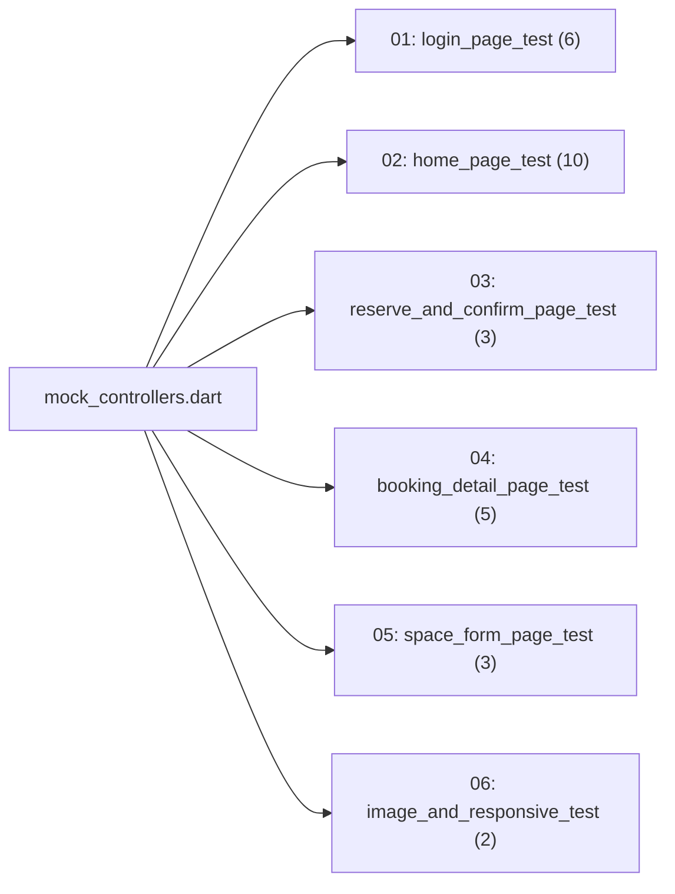

# แผนแบ่งงาน Widget Tests — RentSpace (`rentspace-frontend`)

ชุดเอกสารสำหรับแบ่งงานทดสอบ Widget Test ทั้ง 6 หน้า/โมดูล (รวม **29 เคส**) โดยทุกไฟล์ใช้ระบบ Mocktail ทำงานแบบออฟไลน์ 100% ผ่าน Fixture กลางเดียวกัน

## ตารางแบ่งงานรายคน

| ลำดับ | เอกสารแผนงาน | ไฟล์เทสเป้าหมาย | หน้าจอ / Widget ที่รับผิดชอบ | จำนวนเคส |
|---|---|---|---|---|
| 1 | [01-login-page.md](./01-login-page.md) | `test/pages/login_page_test.dart` | `RentSpaceApp` (Restore), `LoginPage`, `_MobileFrame` | 6 เคส |
| 2 | [02-home-page.md](./02-home-page.md) | `test/pages/home_page_test.dart` | `HomePage` (3 บทบาท), `ProfilePanel`, `StatTile`, `PopScope` | 10 เคส |
| 3 | [03-reserve-and-confirm-page.md](./03-reserve-and-confirm-page.md) | `test/pages/reserve_and_confirm_page_test.dart` | `ReservePage`, `BookingConfirmationPage` | 3 เคส |
| 4 | [04-booking-detail-page.md](./04-booking-detail-page.md) | `test/pages/booking_detail_page_test.dart` | `BookingPage`, `SlipPage`, `showAdminPayoutDialog` | 5 เคส |
| 5 | [05-space-form-page.md](./05-space-form-page.md) | `test/pages/space_form_page_test.dart` | `SpaceForm`, `AvailabilityPage` | 3 เคส |
| 6 | [06-image-and-responsive.md](./06-image-and-responsive.md) | `test/pages/image_and_responsive_test.dart` | `SpaceImage`, `SlipImage`, Viewport `360x740` + คีย์บอร์ด | 2 เคส |

## โครงสร้างภาพรวม

```text
test/fixtures/mock_controllers.dart   <-- ไฟล์กลาง ห้ามแก้ซ้ำซ้อนโดยไม่ตกลงกัน
   ├── TestStore + createMockStore()
   ├── ControllerBundle (MockAuth / MockSpace / MockBooking / MockPayment)
   ├── setupTestChannels() + configureMobileViewport() + resetMobileViewport()
   └── Helpers: fieldByLabel, scrollToAndTap, scrollToAndEnter, submitReasonDialog, dismissSnackBars, unmountApp
```



## กติกากลางก่อนเริ่มเขียน/แก้เทส

1. **Setup ในไฟล์เทสทุกไฟล์**
   - เรียก `TestWidgetsFlutterBinding.ensureInitialized();`
   - ใน `setUpAll` เรียก `registerMockControllerFallbacks();` และ `await setupTestChannels();`
   - ในทุก `testWidgets` เรียก `configureMobileViewport(tester);` และ `addTearDown(() => resetMobileViewport(tester));`
   - จบเคสที่เปิด `RentSpaceApp` หรือ `BookingPage` (ซึ่งมี `Timer.periodic`) ด้วย `await unmountApp(tester);` เพื่อไม่ให้ค้าง Pending Timer
2. **ข้อมูลจำลองใน `mock_controllers.dart` ที่อ้างอิงร่วมกัน**
   - `mockClockNow`: `DateTime(2026, 11, 16, 12, 0)`
   - **Users:** `'1001'` Owner (`owner01@rentspace.test`), `'1002'` Renter (`renter01@rentspace.test`), `'1003'` Admin (`admin01@rentspace.test`), `'1004'` Renter (`mint@rentspace.test`), `'1005'` Owner inactive (`owner02@rentspace.test`)
   - **Spaces:** `'2001'` (`ห้องประชุมสว่างใจ`, approved), `'2002'` (`The Quiet Nook (ห้องอ่านหนังสือ)`, approved), `'2005'` (`พื้นที่จัดเวิร์กช็อป`, pending), `'2098'` (`พื้นที่ปรับปรุงภาพถ่าย`, rejected)
   - **Bookings:** `'3001'` (`confirmed` อดีต), `'3002'` (`confirmed` อนาคต), `'3003'` (`ownerReview`), `'3004'` (`paymentDue`), `'3005'` (`slipReview`), `'3006'` (`completed`), `'3007'` (`canceled`), `'3020'` (`ownerRejected`)
3. **คำสั่งรันตรวจหลังรวมงาน** (รันจากโฟลเดอร์ `rentspace-frontend/`):

```powershell
flutter analyze
flutter test test/pages/
```
